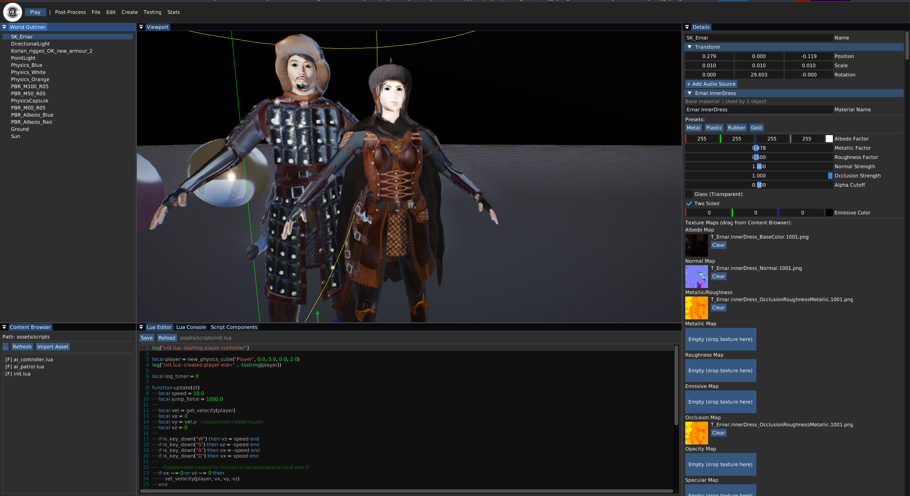

# GaleshiEngine

GaleshiEngine is a minimalist, ECS-based game engine and editor written in C++20. It targets Linux/X11 and uses a Vulkan renderer through bgfx. The project is intended as a compact engine for learning, prototyping, and building small games.

> **Status: pre-alpha (0.2.0).** The editor and most engine subsystems are functional, but the renderer is still under active development. The post-processing stack is functional on the tested Vulkan path, and some editor tools are incomplete. The engine can crash or hang the GPU on some drivers. Use at your own risk.

---

## Features

| System | Status | Notes |
| --- | --- | --- |
| Window and input | Working | SDL3 |
| Input axes | Working | Keyboard, mouse movement, wheel; tunable in Edit -> Preferences |
| Scene and ECS | Working | EnTT, parent-child transforms, entity lifecycle |
| Renderer core | Working | bgfx with the Vulkan backend |
| Deferred PBR | Working | Metallic-roughness PBR with G-Buffer |
| IBL | Working | Irradiance and prefiltered environment cubemaps |
| Shadow maps | Working | 3-cascade directional PSSM, point and spot shadows |
| Tiled light culling | Working | 16x16 tiles, up to 64 point lights in the deferred path |
| Post-processing | Working | DoF, motion blur, atmosphere, and the full stack are tested; effects can be isolated with `GALESHI_EFFECTS` |
| Physics | Working | Jolt rigid bodies and cloth/soft-body simulation |
| Particles | Working | CPU-simulated billboard emitters, editable in Details and serialized in scenes |
| AI and navigation | Working | Recast/Detour NavMesh, path following, behavior trees, and perception |
| Landscape and vegetation | Working | Heightfield sculpting tools and deterministic instanced trees/grass |
| Scripting | Working | Lua 5.4 through sol2, hot reload, animation/AI state control |
| Audio | Working | miniaudio, 2D playback and looping |
| Asset import | Working | Assimp FBX/glTF, PBR materials, skeletal animation |
| Editor | Working | Docking UI, viewport, outliner, details, content browser, and Preferences |
| UI Designer | ✅ Done | Canvas overlay, widget palette (Panel, Text, Button, Image, Slider, Checkbox, Progress, Input, Dropdown, Scroll, Toggle, Layout), live preview, and serialized UI widgets |
| Gizmo | Partial | ImGuizmo is rendered, but its transform is not applied |
| Glass material | WIP | Shader and UI flag exist, render pass is not connected |
| Scene serialization | Working | ECS, materials, landscape/vegetation, animation, and AI components |
| Runtime and packaging | ✅ Done | GameMode is a real editor runtime (`--game <gproj>`) that opens the project, loads `startScene`, and starts playing; AppImage packaging is available |
| Automated tests | None | `BUILD_TESTING` is disabled |

---

## Rendering

The primary rendering path is deferred:

- G-Buffer: albedo/metallic, normal/roughness, world position, and depth.
- Metallic-roughness PBR: GGX distribution, Smith geometry, Schlick Fresnel.
- IBL: generated irradiance and prefiltered environment cubemaps. The deferred lighting shader evaluates the split-sum BRDF analytically to stay within the Vulkan descriptor budget.
- Directional shadows: three-cascade PSSM with log-linear split selection and tight orthographic projections.
- Point shadows: a cubemap for the first point light.
- Spot shadows: up to four spot lights.
- Tiled light culling through a compute shader.
- Frustum culling for scene meshes.
- Animated procedural water with Fresnel environment reflections, screen-space refraction, depth absorption, shoreline/crest foam, and sun sparkle.
- Automatic instancing for repeated static meshes in the main, G-buffer, and shadow passes.
- Procedural groom hair with guide curves, dense skin-aware strands, spring/wind simulation, and anisotropic ribbon shading.
- Skybox and debug line rendering.

There is also a forward PBR fallback in `RenderSystem`, but the deferred path is the primary one and is enabled by default.

Implemented post-processing passes:

- SSAO, HBAO, and GTAO ambient occlusion
- SSR, using an approximate screen-space raymarch
- Bloom
- TAA
- SMAA
- FXAA
- Depth of Field, off globally and enabled by post-process volumes, with automatic focus on the player/nearest character or selected mesh
- Motion Blur
- Atmosphere
- God Rays
- ACES tonemapping
- Color correction
- Vignette
- Chromatic aberration
- Invert
- Spatial post-processing volumes with per-effect tuning for bloom, DoF, motion blur, tonemap, color correction, vignette, ambient occlusion (SSAO/HBAO/GTAO), SSR, anti-aliasing, god rays, and atmosphere.

---

## Physics

- Jolt Physics 5.2.
- Static, dynamic, and kinematic rigid bodies.
- Box, sphere, and capsule shapes.
- Gravity, impulses, linear velocity, and contact callbacks.
- Transform synchronization from Jolt to ECS.
- Cloth/soft-body grid simulation.
- Multithreaded job system.

Joint and constraint interfaces are not exposed yet.

## AI and navigation

- Recast/Detour NavMesh generation from scene meshes and landscape geometry.
- Pathfinding between world-space points and NavAgent waypoint following.
- Direct movement fallback for scenes without a NavMesh.
- Serializable behavior trees with Selector, Sequence, Condition, and Action nodes.
- Default behavior tree with patrol, target acquisition, chase, and attack branches.
- Perception with sight radius, field of view, hearing radius, memory, and AABB line-of-sight checks.
- Player targeting through `PlayerTagComponent` or an entity-name filter.
- Per-entity Lua AI controllers with an `update_ai` callback.
- Debug visualization of the generated NavMesh and AI state.
- Editor inspectors for perception, behavior trees, and player tags.

Squad coordination and shared blackboards are not implemented.

## Scripting

- Lua 5.4 with sol2.
- Hot reload with F5.
- Lifecycle callbacks: `RunOnce()` runs once after the script is loaded (and again after each successful hot reload), then `RunAlways(dt)` runs every frame. The legacy `update(dt)` callback is used as a fallback when `RunAlways` is not defined.
- Entity creation and destruction.
- Transform access: `set_position`, `get_position`, `translate`.
- Input axes and mouse helpers. `get_axis(name)` and `get_axis_raw(name)` read the configured axes; `get_mouse_position()`, `get_mouse_delta()`, `get_mouse_wheel()`, and `is_mouse_button_down(button)` expose raw mouse state.
- The default axes are `Horizontal`, `Vertical`, `Jump`, `Mouse X`, `Mouse Y`, and `Mouse ScrollWheel`. Axes can be tuned in Edit -> Preferences (sensitivity, dead zone, inversion).
- Impulse and velocity control.
- Sound playback.
- Navigation commands for AI agents.
- Entities created by scripts are tagged with `LuaEntityComponent` and removed on hot reload.

```lua
local player = nil

function RunOnce()
    player = new_physics_cube("Player", 0.0, 5.0, 0.0, 2.0)
end

function RunAlways(dt)
    if not player then return end
    local velocity = get_velocity(player)
    -- Per-frame game logic here.
end
```

## Audio

- miniaudio.
- File-based playback, looping, stopping, and playback state checks.
- `AudioSourceComponent` in ECS.
- 3D positional audio with inverse, linear, and exponential attenuation, min/max distance, rolloff, doppler, and a local offset.
- Listener follows the camera or an entity with `AudioListenerComponent`.
- Mixer buses: Master, Music, SFX, Voice, and Ambient, with per-source routing and volume/mute controls in the Audio Mixer window.
- Playback can be triggered from Lua, editor actions, or collision callbacks.

## Assets

- Assimp import for FBX and glTF.
- Meshes, PBR materials, and textures with caching.
- Primitive cube, sphere, and capsule meshes.
- Landscape heightfield generation with Raise, Lower, Smooth, Flatten, and Noise brushes.
- Deterministic procedural tree and grass generation, rendered with per-instance matrices and instanced shadow passes.
- Skeletal animation clip sampling with weighted pose blending.
- Serializable animation state machines with parameters, triggers, transitions, and blend durations.
- PBR material parameters and texture slots.

## Editor

- Docking ImGui interface.
- Viewport with orbit camera, selection, and drag movement.
- World Outliner and Details panels.
- Content Browser with model import.
- Create entities, lights, physics primitives, cloth, landscape, and AI agents.
- `Testing -> Build Scene` rebuilds the PBR test scene: 12 colored spheres (3 albedo samples and a 3x3 metallic/roughness grid) plus the physics demo objects and ground.
- When `scene.json` is missing, the editor starts with an empty scene; the test scene is not built automatically.
- PBR material editing with Metal, Plastic, Rubber, and Gold presets.
- Landscape sculpting with brush settings, undo snapshots, and vegetation regeneration.
- Animation state machine editor with states, clips, parameters, and transitions.
- Perception and behavior-tree inspectors, plus player-tag and AI debug controls.
- NavMesh generation from the Create menu.
- Undo/Redo through scene snapshots.
- Scene save/load in JSON format.
- Play/Stop mode with physics reset and scene restoration.
- Debug overlay for grids, axes, light volumes, and NavMesh.

The ImGuizmo manipulator is currently visual only. Dragging the center marker moves the selected object, but ImGuizmo's returned transform is not applied to the ECS.

---

## Building

### Requirements

- Linux/X11. The Wayland path is not tested.
- CMake 3.24 or newer.
- C++20 compiler: GCC 13+, Clang 15+, or MSVC 19.35+.
- Ninja.
- A working Vulkan driver and Vulkan SDK.
- `shaderc` available in `PATH` or in the Vulkan SDK.
- X11 development headers.
- FreeType development files.
- Network access during the first configure, because dependencies are fetched with FetchContent.

### Debug build

```bash
git clone <repo> GaleshiEngine
cd GaleshiEngine
cmake --preset debug --fresh
cmake --build --preset debug -j"$(nproc)"
```

```bash
bash scripts/compile_shaders.sh build/debug shaders build/debug/bin/shaders
```

### Running

```bash
./build/debug/bin/GaleshiEditor
```

Optional flags:

```bash
./GaleshiEditor --debug
./GaleshiEditor --game
```

`--debug` enables verbose logging. `--game` hides the editor panels and runs the viewport in game mode, but it still uses the editor executable.

### GaleshiRuntime

```bash
cmake --preset debug --fresh
cmake --build --preset debug -j"$(nproc)"
./build/debug/bin/GaleshiRuntime
```

`GaleshiRuntime` is a standalone editor runtime target. It accepts `--game <path>.gproj` to open a project and load its `startScene`, and runs the scene directly without the full editor UI.

### Release build

```bash
cmake --preset release --fresh
cmake --build --preset release -j"$(nproc)"
./build/release/bin/GaleshiEditor
```

### AppImage (single-file editor)

The editor can be packaged as a single-file AppImage that contains the executable, engine assets, shaders, the bundled DejaVu Sans font, and the non-system shared libraries:

```bash
./scripts/package_engine_appimage.sh
./dist/GaleshiEngine-x86_64.AppImage
```

The script builds the release preset by default. Set `SKIP_BUILD=1` to reuse an existing `build/release`. On first use it downloads `linuxdeploy` and `appimagetool` into `.tools/` and produces the image in `dist/`.

Requirements and caveats:

- Linux x86_64 with a working Vulkan driver and X11 or XWayland. GPU drivers, Vulkan ICDs, FreeType, and core system libraries are host-provided and cannot be bundled.
- Direct execution uses FUSE. On systems without it, run the image with `--appimage-extract-and-run` or set `APPIMAGE_EXTRACT_AND_RUN=1`.
- The image is built against the host glibc. For distribution to older systems, build it in an older environment such as Ubuntu 22.04.
- The AppImage bundles the editor, not a game project. Project files remain external and are opened through the Project Manager.

### CLI helper

The repository contains a small wrapper for packaging and running builds. It expects an existing debug build:

```bash
./galeshi package Game.gproj
./galeshi run Game.gproj
```

The wrapper's `editor` command starts the binary from the repository root. Because the renderer loads `shaders/` and `assets/` relative to the working directory, use `cd build/debug/bin && ./GaleshiEditor` for direct editor launches.

---

## Project files and packaging

A project file is a JSON document such as `Game.gproj`:

```json
{
  "name": "MyGame",
  "startScene": "scene.json"
}
```

Packaging is experimental:

```bash
./galeshi package Game.gproj
```

---

## Controls

| Input | Action |
| --- | --- |
| Right mouse drag | Orbit the editor camera |
| Mouse wheel | Zoom |
| Arrow keys | Pan the camera |
| Left click | Select an entity |
| Left drag on center marker | Move the selected entity |
| W / E / R | Switch gizmo mode (translate / rotate / scale) |
| F | Focus the camera on the selected entity |
| Delete | Delete the selected entity |
| Ctrl+I | Import a model |
| Ctrl+S | Save the scene |
| Ctrl+O | Load a scene |
| Ctrl+Z / Ctrl+Y | Undo / Redo |
| Ctrl+, | Open Preferences |
| F5 | Hot-reload `assets/scripts/init.lua` |

The ImGuizmo handles are visible, but only the center-marker drag currently modifies the scene.

## Known limitations

- The renderer is pre-alpha and may crash or hang the GPU on some drivers.
- Linux/X11 is the only tested platform. Wayland is untested.

## Roadmap

### Stability

- [ ] Run the Vulkan validation layers on all render passes.
- [x] Wire the glass render pass.
- [x] Apply ImGuizmo transforms to the ECS.

### Editor and data

- [x] Complete scene serialization for all ECS components.
- [x] Landscape formation tools and tree/grass instancing
- [x] Scene loading progress bar dialog
- [x] Separate project implementation and resources (show project creating or selecting window at startup)
- [x] Import content (fbx, glTF, textures, wav, mp3 sounds) into project
- [x] Lua game logic scripting system and editor under viewport (tab system on the right side area of Content browser). Lua bindings to C++ functions
- [x] Add logo to the left up corner of an editor
- [x] Add naming labels to Outliner and Properties panels
- [x] Show small splash window at startup
- [x] Add input axis system for keyboard and mouse
- [x] Add RunOnce and RunAlways system functions
- [x] UI designing system
- [x] Standalone one file container build (AppImage for the editor)

### Rendering

- [ ] Improve SSR quality and projection.
- [ ] Add instancing for repeated meshes.
- [ ] Add occlusion culling and LOD.
- [ ] Tune PSSM bias and normal offsets.
- [ ] Add per-object motion vectors for Motion Blur.
- [ ] Add TAA motion vectors.
- [ ] Add quality scaling and dynamic resolution.
- [x] Add texture compression and compressed texture loading/reading
- [x] Add two sided mode for normals option as checkbox to Material properties
- [x] Rename material slots to their names in FBX file format
- [x] Add Particles system
- [x] Add Postprocessing volume

### Physics 
- [x] Add various physics properties to collision shapes
- [x] Allow move collission shapes on XY coordinates
- [x] Set collission shapes invisible when user press play

### Content systems

- [x] Animation blending and state machines.
- [x] 3D audio and mixer buses.
- [x] Improve AI with behavior trees and perception.

---

## Third-party libraries

| Component | Library | License |
| --- | --- | --- |
| Window and input | [SDL3](https://github.com/libsdl-org/SDL) | zlib |
| Rendering | [bgfx](https://github.com/bkaradzic/bgfx) | BSD-2-Clause |
| Image loading | [bimg](https://github.com/bkaradzic/bimg) | BSD-2-Clause |
| Base library | [bx](https://github.com/bkaradzic/bx) | BSD-2-Clause |
| UI | [Dear ImGui](https://github.com/ocornut/imgui) | MIT |
| Gizmo | [ImGuizmo](https://github.com/CedricGuillemet/ImGuizmo) | MIT |
| Math | [GLM](https://github.com/g-truc/glm) | MIT |
| Model import | [Assimp](https://github.com/assimp/assimp) | BSD-3-Clause |
| Physics | [Jolt Physics](https://github.com/jrouwe/JoltPhysics) | MIT |
| Navigation | [RecastNavigation](https://github.com/recastnavigation/recastnavigation) | zlib |
| ECS | [EnTT](https://github.com/skypjack/entt) | MIT |
| Logging | [spdlog](https://github.com/gabime/spdlog) | MIT |
| JSON | [nlohmann/json](https://github.com/nlohmann/json) | MIT |
| Lua bindings | [sol2](https://github.com/ThePhD/sol2) | MIT |
| Lua | [Lua](https://www.lua.org/) | MIT |
| Audio | [miniaudio](https://github.com/mackron/miniaudio) | Public domain / MIT-0 |
| Font rendering | [FreeType](https://freetype.org/) | FreeType License / GPLv2 |
| UI font | [DejaVu Sans](https://dejavu-fonts.github.io/) | Bitstream Vera License / public domain |

## Credits

- bgfx for the renderer abstraction.
- Dear ImGui for the editor tooling.
- Jolt Physics for rigid bodies and soft bodies.
- Recast and Detour for navigation.
- The SSAO chain and camera motion blur implementations follow the approach used by [tobspr/renderpipeline](https://github.com/tobspr/renderpipeline).
- HBAO follows the horizon-based formulation of Bavoil and Sainz; GTAO follows the horizon-integration formulation of Jimenez et al. (2016).
- All library authors listed above.

## License

MIT. See [LICENSE](LICENSE).

All third-party libraries are distributed under their own licenses.
