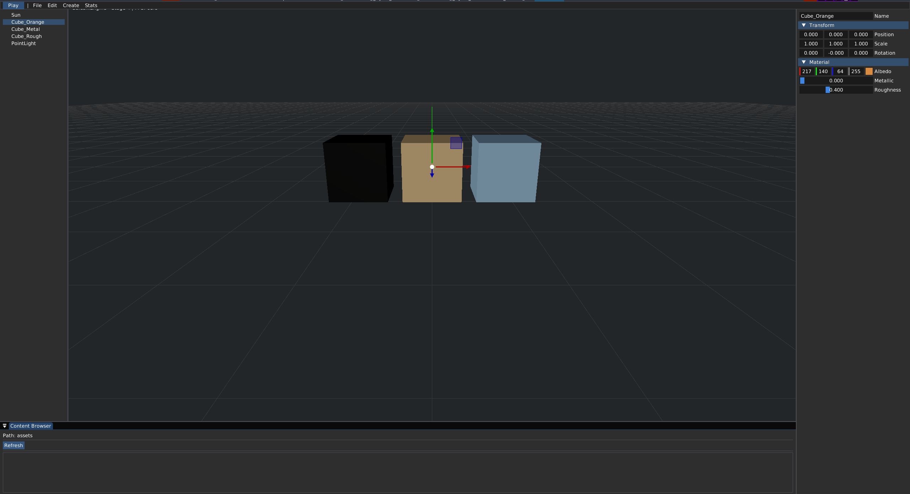

# GaleshiEngine

A minimalist game engine inspired by Unreal Engine 5. The goal is a cross-platform editor with a Vulkan renderer, physics, AI, and the ability to write C++ directly inside the editor.

**Current status: Stage 2 complete.** Window, Vulkan renderer, ImGui editor, basic PBR shader, and a rotating cube all work.

---

## Features

| System             | Status  | Library                              |
| ------------------ | :-----: | ------------------------------------ |
| Window and input   | Done    | SDL3                                 |
| Renderer (Vulkan)  | Done    | bgfx + bimg + bx                     |
| Editor UI          | Done    | Dear ImGui (docking)                 |
| Gizmo              | WIP     | ImGuizmo (linked, not wired)         |
| PBR shader         | Partial | Basic model (Lambert + Blinn-Phong)  |
| FBX/glTF import    | WIP     | Assimp (linked)                      |
| Scene / ECS        | WIP     | EnTT (linked)                        |
| Physics            | WIP     | Jolt Physics (rigid + soft)          |
| AI / NavMesh       | WIP     | Recast and Detour                    |
| C++ scripting      | Planned | Cling                                |

---

## Building

### Requirements

- CMake 3.24 or newer (on CMake 4.x requires `CMAKE_POLICY_VERSION_MINIMUM=3.5`)
- C++20 compiler (GCC 13+, Clang 15+, MSVC 19.35+)
- Ninja (or Make)
- Vulkan SDK (`vulkaninfo` must work)
- SDL3 is pulled automatically via FetchContent

### Linux (Gentoo / Arch / Fedora / Ubuntu)

```bash
git clone <repo> GaleshiEngine
cd GaleshiEngine
cmake --preset debug --fresh
cmake --build --preset debug --target GaleshiEditor -j$(nproc)

./build/debug/bin/GaleshiEditor
or 
./build/debug/bin/GaleshiEditor --debug
```

Technology stack
Component	Library	License
Window / input	SDL3	zlib
Rendering	bgfx	BSD-2
UI	Dear ImGui	MIT
Gizmo	ImGuizmo	MIT
Math	GLM	MIT
Model import	Assimp	BSD-3
Physics	Jolt Physics	MIT
Navigation	RecastNavigation	zlib
ECS	EnTT	MIT
Logging	spdlog	MIT

All dependencies are pulled via FetchContent on the first configuration. The first build takes 15 to 30 minutes (bgfx and Assimp); subsequent builds take seconds.

## Roadmap

### P0 — Physics ↔ ECS
- [✔] `PhysicsSystem::SyncTransformsToECS()` — read body positions from Jolt, write to `TransformComponent`
- [✔] Call `SyncTransformsToECS()` from `OnUpdate()` after `PhysicsSystem::Update()`
- [✔] Spawn test scene: 5 dynamic cubes (`CreateBox()` + `RigidBodyComponent`)
- [✔] Verify cubes fall and settle on the floor

### P1 — Scripting & Audio
- [✔] Lua ↔ ECS: pass entity IDs from C++ to Lua (`new_entity()`)
- [✔] Implement real `set_position(entity, x, y, z)` on `TransformComponent`
- [✔] Add `get_position`, `translate` bindings
- [✔] Hot-reload `init.lua` on keypress
- [✔] `AudioSystem::PlaySound(path)` via miniaudio
- [✔] `AudioSourceComponent` in ECS
- [✔] Trigger sound on keypress / collision / script event

### P2 — Post-processing
- [✔] Off-screen FBO: color + depth + normal + position
- [✔] `PostProcessManager::Render(fbo)` — takes scene textures
- [✔] First effect: color inversion (pipeline smoke test)
- [✔] SSAO from depth + normal
- [✔] SSR as optional pass
- [✔] TAA / FXAA / SMAA selectable in UI

### P3 — Navigation, Editor, Serialization
- [ ] Recast NavMesh generation from `MeshComponent` scene
- [ ] `NavAgentComponent` + Detour pathfinding
- [ ] Scene hierarchy panel (drag & drop)
- [ ] Inspector: edit `Transform`, `RigidBody`, `Mesh`
- [ ] ImGuizmo translate/rotate/scale
- [ ] Undo/Redo (`m_history`, `m_historyIndex`)
- [ ] `Scene::Save/Load(path)` via nlohmann/json (`*.gscn`)

### P4 — Long-term
- [ ] Multi-threaded ECS job system (integrated with `JPH::JobSystemThreadPool`)
- [ ] Asset pipeline: `.fbx` / `.gltf` → `.gasset` with cache
- [ ] Node-based material editor
- [ ] Blueprint-like visual scripting over Lua
- [ ] Packaging: `GaleshiEditor --package Game.gproj`
- [ ] CLI: `galeshi build`, `galeshi run`, `galeshi package`

    ☑

    Stage 1. Framework: CMake, SDL3, ImGui, logging
    ☑

    Stage 2. Renderer: bgfx/Vulkan, shaders, PBR cube, ImGui docking
    □

    Stage 3. Scene and assets:
        □

        Scene on EnTT (Transform, Mesh, Material, Camera, Light)
        □

        AssetManager with FBX/glTF/OBJ loading through Assimp
        □

        Full PBR (metallic/roughness/normal map)
        □

        Content Browser with files and drag-n-drop
        □

        Working Outliner and Details panels
        □

        ImGuizmo for translate/rotate/scale
    □

    Stage 4. World and physics:
        □

        Landscape (heightmap) and sculpting tools
        □

        Jolt Physics: rigid and soft body
        □

        ECS to physics synchronization
    □

    Stage 5. AI and scripting:
        □

        Recast/Detour: NavMesh, pathfinding
        □

        AI Perception (sight/hearing via raycasts)
        □

        State Machines, Events, Ticks
        □

        Embedded C++ via Cling

Known limitations

    Linux/X11 only at the moment. The Wayland path in bgfx is untested.

    Vulkan backend only. An OpenGL/DX12 foundation exists but is untested.

    PBR is currently basic: Lambert + Blinn-Phong, no IBL, no metallic/roughness maps.

    Jolt is linked but does not initialize on some builds because the Jolt target is not always created. Temporarily disabled until Stage 4.

    ImGui ViewportsEnable is on, but the multi-window backend is not implemented. If a single workspace is preferred, disable the flag in Application.cpp.

    Cling (the C++ interpreter) is not yet integrated.

License

MIT. See LICENSE.

All third-party libraries are distributed under their own licenses (see the table above).
Credits

    bgfx for a solid cross-API renderer

    Dear ImGui for the tooling that makes an editor possible

    Jolt Physics for a modern physics engine with soft body support

    All library authors listed above


